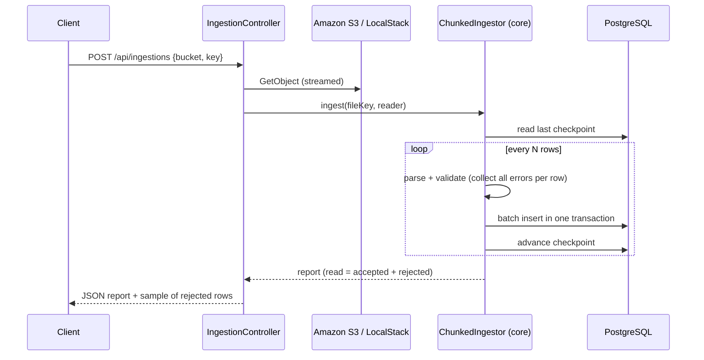

# bulk-file-ingestion-service

Spring Boot 3 / Java 21 service that streams large CSV files from **Amazon S3** into **PostgreSQL** in checkpointed batches. Every row is either loaded or reported as rejected with its line number and reasons, and an interrupted run resumes where it stopped without loading anything twice.

> **Portfolio project.** Independently written for demonstration, using synthetic data only. It does not contain code, data or designs from any employer or client.

## Business problem

Partners and upstream systems drop daily files that can run to millions of rows. Typical failure modes are an out-of-memory crash on a big file, a database blip halfway through that forces a full reload (and duplicates), and bad rows that either stop the whole file or vanish silently. This service is built so that each of those has a defined, tested outcome.

## How it works



| Guarantee | Mechanism |
|---|---|
| Constant memory | File is read line by line from the S3 stream; only one batch is held in memory |
| No silent loss | Each processed row is counted as accepted or rejected; `balanced` in the report confirms the totals match |
| Resume, no duplicates | Checkpoint advances only after a batch commits; reruns skip to it. `ON CONFLICT DO NOTHING` is a second safeguard |
| Useful rejects | All validation errors for a row are returned together, with line numbers |

## Tech stack

Java 21 · Spring Boot 3.3 (Web, JDBC, Validation, Actuator) · AWS SDK for Java v2 (S3) · PostgreSQL 16 · LocalStack · Terraform (S3, IAM) · Docker Compose · JUnit 5 · GitHub Actions

## Run locally

Prerequisites: JDK 21, Maven 3.9+, Docker, AWS CLI.

```bash
cp .env.example .env
docker compose up --build -d

# Upload the synthetic sample file to the LocalStack bucket
# (LocalStack accepts any dummy credentials, for example "test"/"test")
aws --endpoint-url http://localhost:4566 s3 mb s3://landing
aws --endpoint-url http://localhost:4566 s3 cp sample-data/transactions.csv s3://landing/inbound/transactions.csv

curl -X POST localhost:8081/api/ingestions \
  -H 'Content-Type: application/json' \
  -d '{"bucket":"landing","key":"inbound/transactions.csv"}'
```

Generate a bigger file with `java tools/GenerateTransactions.java 1000000 > sample-data/big.csv`.

## Tests

```bash
mvn verify
```

The core tests cover RFC 4180 quoting, multi-error rejection, a 200,000-row streamed file in bounded batches, a simulated database outage followed by a resume with no duplicates, and header validation.

## Infrastructure

`infra/terraform` creates a landing bucket with public access blocked, versioning, KMS encryption and a lifecycle rule for processed files, plus a least-privilege IAM policy that can only read the `inbound/` prefix. CI runs `terraform fmt`, `init` and `validate`.

## Security notes

- No credentials in the repository. Locally, LocalStack dummy keys are used; in AWS the service should run under an IAM role.
- Rejected-row samples include the raw line. With real data that may contain PII, mask or drop `rawLine` before returning it.
- The database password is read from the environment (`DB_PASSWORD`).

## Limitations and next steps

- One file per request, processed synchronously. Next step: trigger from S3 event notifications through SQS and process asynchronously.
- Persist rejected rows to a quarantine table or S3 prefix instead of returning them only in the response.
- Add Testcontainers integration tests for the JDBC and S3 adapters.

## License

MIT
